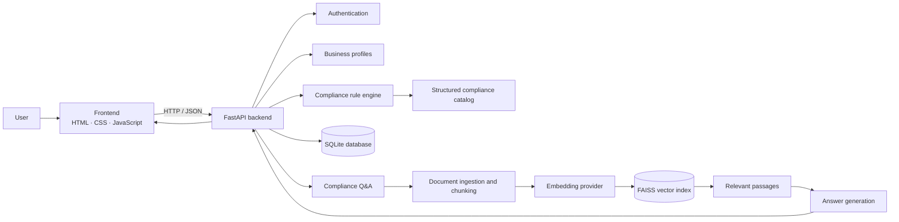

<div align="center">

# MSMEase — AI-Powered MSME Compliance Assistant

**Understand applicable compliance. Organise obligations. Find grounded regulatory guidance.**

An AI-assisted compliance support platform designed to help Indian micro, small, and medium enterprises (MSMEs) explore regulatory obligations through business profiles, an explainable rule engine, and retrieval-augmented knowledge search.

[Features](#key-features) · [Architecture](#system-architecture) · [Setup](#getting-started) · [API](#api-overview) · [Team](#project-team) · [References](#references) · [License](#license)

</div>

---

## Overview

MSMEase brings structured compliance matching and regulatory knowledge retrieval into one application. A user can create an account, maintain business profiles, generate a profile-specific compliance checklist, update progress, and ask questions against indexed knowledge documents.

The project is a software prototype and educational project. It is **not a substitute for advice from a qualified legal, tax, accounting, or compliance professional**. Applicability can depend on facts and amendments not represented in the current knowledge base. Always verify important decisions against the latest official notifications and legislation.

## Key Features

- **Account access:** sign-up, login, and token-based authentication.
- **Business profiles:** create and revisit saved business profiles.
- **Rule-based compliance matching:** evaluate profile information against structured compliance rules and return explanations for applicability decisions.
- **Compliance dashboard:** review generated results, categories, progress, due-date status, and individual compliance details.
- **Progress tracking:** update the status of compliance items for a saved profile.
- **AI-assisted compliance Q&A:** retrieve relevant passages from indexed knowledge and generate an answer grounded in those passages.
- **Knowledge-base management:** ingest supported documents or text, inspect indexed documents and statistics, delete entries, and rebuild the vector index.
- **Configurable model providers:** use the local fallback configuration or configure supported Gemini/OpenAI providers for embeddings and answer generation.
- **Interactive API documentation:** explore and test backend endpoints through FastAPI's Swagger UI.

> **Scope note:** the included compliance catalog is a maintained prototype dataset, not a guarantee of complete or current coverage across every Indian state, industry, entity type, or law.

## Technology Stack

| Layer | Technologies |
|---|---|
| Frontend | HTML, CSS, JavaScript |
| Backend API | Python, FastAPI, Uvicorn |
| Data validation | Pydantic |
| Persistence | SQLAlchemy, SQLite |
| Authentication | bcrypt password hashing, JWT-based tokens |
| Compliance evaluation | Python rule engine and structured JSON catalog |
| Retrieval | Document ingestion and chunking, embeddings, FAISS vector search |
| Optional AI providers | Google Gemini and OpenAI, configured through environment variables |

## System Architecture



### Typical compliance workflow

1. A user signs in and submits a business profile.
2. The backend validates and stores the profile.
3. The rule engine evaluates the profile against the structured compliance catalog.
4. The backend stores the results and returns applicability details and explanations.
5. The frontend displays the results and allows the user to track progress.

### Typical knowledge Q&A workflow

1. A document or text is added to the knowledge base.
2. The ingestion pipeline extracts text, splits it into overlapping chunks, and stores metadata.
3. The configured embedding provider creates vectors, which are indexed for similarity search.
4. A user asks a compliance question; the system retrieves relevant passages and uses the configured answer provider to form a grounded response.

## Repository Structure

```text
MSMEs-Assistant-main/
├── backend/
│   ├── main.py                 # FastAPI app and API routes
│   ├── auth.py                 # Password hashing and token helpers
│   ├── database.py             # Database configuration
│   ├── models.py               # SQLAlchemy data models
│   ├── schemas.py              # Request/response validation schemas
│   ├── rule_engine.py           # Profile-to-compliance evaluation
│   ├── compliance_data.json     # Structured compliance catalog
│   ├── documents_api.py         # Document-related API routes/models
│   ├── rag_config.py            # Retrieval and provider configuration
│   ├── rag_ingest.py            # Text extraction and chunking
│   ├── rag_embeddings.py        # Embedding provider interface
│   ├── rag_store.py             # FAISS vector index operations
│   ├── rag_llm.py               # Retrieval and answer generation
│   ├── seed_knowledge.py        # Knowledge-base seeding utilities
│   ├── migrate_db.py            # Database migration utility
│   ├── test_engine.py           # Rule-engine tests
│   ├── test_rag.py              # Retrieval tests
│   ├── test_suite.py            # Additional test suite
│   ├── requirements.txt         # Backend Python dependencies
│   └── data/                    # Local vector-index data
├── frontend/
│   ├── index.html               # Application interface
│   ├── style.css                # Styling and responsive layout
│   ├── app.js                   # Frontend logic and API calls
│   └── assets/                  # Fonts and other static assets
├── .env.example                 # Example environment configuration
└── README.md
```

## Getting Started

### Prerequisites

- Python 3.10 or later (use a version supported by the dependencies in your environment).
- pip.
- A modern web browser.
- Optional: an API key for a supported cloud model provider. The default configuration is intended to use the local provider mode.

### 1. Download and enter the project

Open a terminal in the extracted project directory — the directory containing `README.md` and the `backend` and `frontend` folders.

### 2. Create and activate a virtual environment (recommended)

**Windows PowerShell:**

```powershell
python -m venv .venv
.\.venv\Scripts\Activate.ps1
```

If PowerShell blocks activation, you can run the Python commands below using `.\.venv\Scripts\python.exe` without activating the environment.

**macOS/Linux:**

```bash
python3 -m venv .venv
source .venv/bin/activate
```

### 3. Install backend dependencies

The requirements file is inside `backend`, so run this from the project root:

```powershell
python -m pip install -r backend/requirements.txt
```

On macOS/Linux, the equivalent command is:

```bash
python -m pip install -r backend/requirements.txt
```

If an import error names a package that is not listed in `backend/requirements.txt`, install/record the project's complete dependency set before continuing; do not assume the requirements file covers every optional provider or retrieval dependency in every environment.

### 4. Configure environment variables

Copy `.env.example` to `.env` in the project root, then edit it for your environment. You can also use `backend/.env.example` as a reference.

```powershell
Copy-Item .env.example .env
```

Keep real API keys and production secrets private. **Do not commit `.env` or paste secret keys into issue reports.** Replace example/default administrative secrets before any deployment. Provider names and settings are documented in the example environment file.

### 5. Start the backend API

From the project root, run:

```powershell
python -m uvicorn main:app --app-dir backend --reload --port 8000
```

Alternatively, change into the backend directory first:

```powershell
cd backend
python -m uvicorn main:app --reload --port 8000
```

The API should be available at:

- API base: <http://127.0.0.1:8000>
- Interactive Swagger docs: <http://127.0.0.1:8000/docs>
- Health check: <http://127.0.0.1:8000/api/health>

Keep the backend terminal running while using the frontend. If startup fails, read the **first Python traceback above** the final Uvicorn import error; it often identifies the actual missing package or failing import.

### 6. Start the frontend

Open a **second terminal** from the project root:

```powershell
cd frontend
python -m http.server 8080
```

Then visit <http://127.0.0.1:8080>.

The frontend is served as static HTML, CSS, and JavaScript and does not require a separate JavaScript build step. If the browser cannot reach the API, check that the backend is running and review the API base configuration in `frontend/app.js` for the local development setup.

### 7. Run tests

From the project root:

```powershell
python backend/test_engine.py
python backend/test_rag.py
python backend/test_suite.py
```

Run tests in the configured virtual environment. Some retrieval tests may require dependencies, a local index, or provider configuration beyond the minimal requirements file.

## API Overview

The main API includes endpoints for:

| Area | Example endpoints | Purpose |
|---|---|---|
| Health and catalog | `GET /api/health`, `GET /api/compliance-catalog` | Check service health and inspect the structured catalog |
| Authentication | `POST /api/auth/signup`, `POST /api/auth/login`, `GET /api/auth/me` | Create an account, log in, and retrieve the current user |
| Business profiles | `GET/POST /api/profiles`, `GET /api/profiles/{profile_id}` | Create and retrieve profiles belonging to the authenticated user |
| Compliance results | `POST /api/profiles/{profile_id}/generate`, `GET /api/profiles/{profile_id}/results` | Generate and retrieve profile-specific results |
| Result progress | `PATCH /api/profiles/{profile_id}/results/{rule_id}` | Update a compliance item's status or related progress fields |
| Compliance Q&A | `POST /api/compliance/ask` | Ask a question using retrieved knowledge |
| Knowledge base | `/api/knowledge/*` | Search, ingest, inspect, reindex, and manage knowledge documents |

For request schemas, authentication requirements, and response examples, use the live API documentation at `/docs` while the server is running.

## Configuration

Common environment variables include:

| Variable | Purpose |
|---|---|
| `FAISS_INDEX_PATH` | Location of the FAISS vector index |
| `EMBEDDING_PROVIDER` | Embedding provider selection (`local`, `gemini`, or `openai`, subject to installed dependencies/configuration) |
| `EMBEDDING_MODEL` | Embedding model identifier |
| `LLM_PROVIDER` | Answer-generation provider selection (`local`, `gemini`, or `openai`) |
| `GEMINI_API_KEY` | Optional Google Gemini API credential |
| `OPENAI_API_KEY` | Optional OpenAI API credential |
| `RAG_CHUNK_SIZE` | Target text chunk size for retrieval ingestion |
| `RAG_CHUNK_OVERLAP` | Overlap between adjacent chunks |
| `RAG_TOP_K` | Number of relevant passages to retrieve |
| `ADMIN_API_KEY` | Administrative access secret; set a strong private value outside local development |

Exact behavior depends on the installed package versions and provider configuration. Never use example credentials as production secrets.

## Security, Privacy, and Responsible Use

- Keep secrets in environment variables and out of source control.
- Use HTTPS, a strong secret-management strategy, and production-grade database configuration before deployment.
- Review authentication, authorization, upload validation, rate limiting, logging, and error handling before exposing the service publicly.
- Treat uploaded documents and business profiles as potentially sensitive data; define retention and access policies before real-world use.
- AI-generated answers may be incomplete or incorrect. Check citations/source documents and verify the latest official rules before acting.
- This repository is a prototype and should undergo security, legal, and compliance review before production use.

## Project Team

This project is organised across three complementary responsibilities:

| Role | Professional responsibility |
|---|---|
| **Backend Engineering & API Development** | Designs and implements the FastAPI services, data models, authentication, compliance evaluation logic, and backend integrations. |
| **Frontend Engineering & User Experience** | Develops the browser interface, responsive layouts, dashboard interactions, and client-side communication with backend APIs. |
| **System Integration & AI/Knowledge Pipeline** | Coordinates frontend-backend integration, configures retrieval and embedding workflows, validates end-to-end behavior, and supports testing and deployment readiness. |

Add each contributor's name and relevant profile link to the corresponding role before publishing the repository. Do not list a person as a contributor without their agreement.

## References

The following official documentation and primary-source portals are useful for development and for verifying regulatory information. The applicable law, thresholds, forms, and deadlines should always be checked against the latest official publication.

### Engineering documentation

- [FastAPI Documentation](https://fastapi.tiangolo.com/) — API framework, dependency injection, and OpenAPI documentation.
- [Uvicorn Documentation](https://www.uvicorn.org/) — ASGI server and local development execution.
- [SQLAlchemy Documentation](https://docs.sqlalchemy.org/) — database access and ORM patterns.
- [Pydantic Documentation](https://docs.pydantic.dev/) — data validation and settings concepts.
- [FAISS: similarity search and clustering of dense vectors](https://github.com/facebookresearch/faiss) — vector similarity search library.
- [OpenAI API Documentation](https://platform.openai.com/docs) — optional model and embedding API reference.
- [Google AI for Developers](https://ai.google.dev/gemini-api/docs) — optional Gemini API reference.

### Indian regulatory and government sources

- [Ministry of Micro, Small & Medium Enterprises](https://msme.gov.in/) — MSME policy and official ministry updates.
- [Udyam Registration Portal](https://udyamregistration.gov.in/) — official MSME registration information.
- [Goods and Services Tax Portal](https://www.gst.gov.in/) — GST services and official taxpayer resources.
- [Ministry of Corporate Affairs](https://www.mca.gov.in/) — company and corporate regulatory information.
- [Employees' Provident Fund Organisation](https://www.epfindia.gov.in/) — EPF-related official information.
- [Employees' State Insurance Corporation](https://www.esic.gov.in/) — ESI-related official information.
- [Tamil Nadu Government Portal](https://www.tn.gov.in/) — state government departments and services.
- [India Code](https://www.indiacode.nic.in/) — central and state legislation published through the official legislative portal.
- [e-Gazette of India](https://egazette.gov.in/) — official Gazette notifications.

These links are reference starting points, not a claim that every catalog entry has been independently verified against the latest amendment. Where available, consult the specific Act, rule, notification, department circular, or Gazette publication relevant to the obligation.

## Acknowledgments

MSMEase was developed as a collaborative effort to explore how software engineering and AI-assisted information retrieval can make complex compliance information easier for small businesses to navigate. We acknowledge the maintainers of the open-source frameworks and libraries used by the project, including FastAPI, Uvicorn, SQLAlchemy, Pydantic, and FAISS, whose documentation and tooling support rapid prototyping and maintainable development.

We also acknowledge the public institutions that publish legislation, notifications, and guidance relevant to Indian businesses. Their official portals are essential reference points for building and validating a regulatory knowledge base. The project team appreciates the feedback, testing, and review that help identify gaps in usability, data coverage, reliability, and security.

All contributors should be credited for their actual work, and all third-party libraries, datasets, documents, and other assets remain subject to their respective licences and terms. The presence of a source in this README does not imply endorsement of MSMEase by that source or institution.

## License

This project is intended to be distributed under the **MIT License**. Copyright in the original project code and project-authored materials remains with the project owner(s) or their respective copyright holders; publishing this repository does not transfer ownership of those materials. The MIT License grants recipients permission to use, copy, modify, merge, publish, distribute, sublicense, and/or sell copies of the covered software, subject to retaining the copyright and permission notice. The software is provided “as is”, without warranty or liability, as stated in the licence.

Before public release, replace the copyright-holder placeholder below with the name of the actual owner or owners and add a root-level `LICENSE` file containing the complete MIT License text. Do not imply ownership of third-party dependencies or materials.

```text
MIT License

Copyright (c) [YEAR] [PROJECT OWNER / COPYRIGHT HOLDER]

Permission is hereby granted, free of charge, to any person obtaining a copy
of this software and associated documentation files (the "Software"), to deal
in the Software without restriction, including without limitation the rights
to use, copy, modify, merge, publish, distribute, sublicense, and/or sell
copies of the Software, and to permit persons to whom the Software is
furnished to do so, subject to the following conditions:

The above copyright notice and this permission notice shall be included in all
copies or substantial portions of the Software.

THE SOFTWARE IS PROVIDED "AS IS", WITHOUT WARRANTY OF ANY KIND, EXPRESS OR
IMPLIED, INCLUDING BUT NOT LIMITED TO THE WARRANTIES OF MERCHANTABILITY,
FITNESS FOR A PARTICULAR PURPOSE AND NONINFRINGEMENT. IN NO EVENT SHALL THE
AUTHORS OR COPYRIGHT HOLDERS BE LIABLE FOR ANY CLAIM, DAMAGES OR OTHER
LIABILITY, WHETHER IN AN ACTION OF CONTRACT, TORT OR OTHERWISE, ARISING FROM,
OUT OF OR IN CONNECTION WITH THE SOFTWARE OR THE USE OR OTHER DEALINGS IN THE
SOFTWARE.
```

---

<div align="center">

**MSMEase — making compliance information more accessible to India's small businesses.**

</div>
